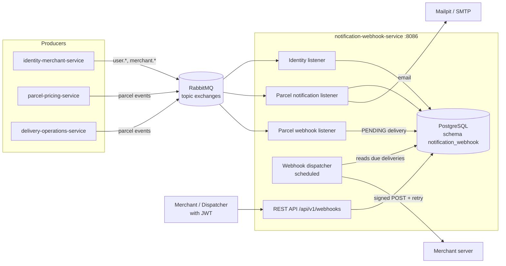
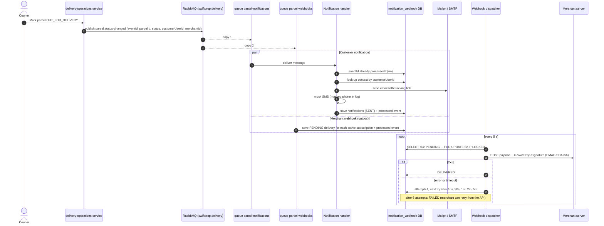
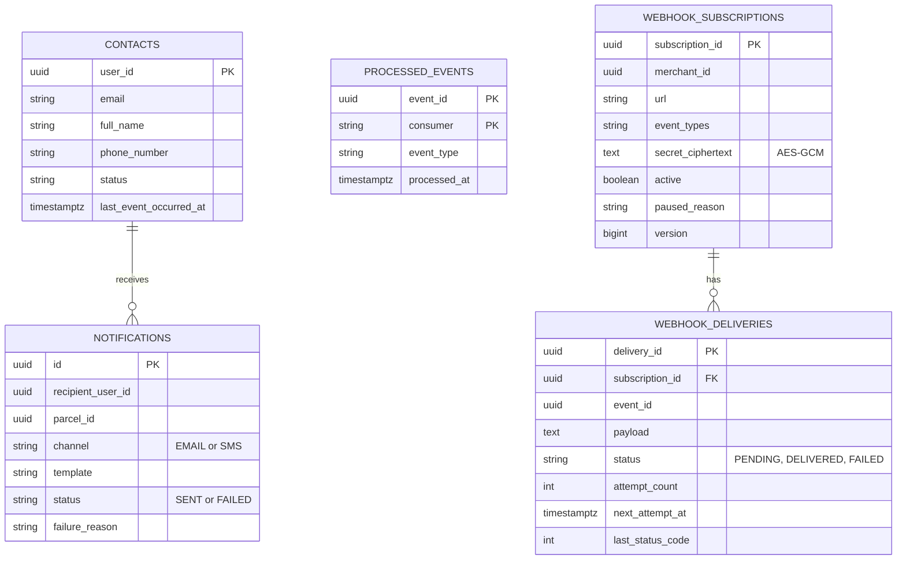

# Notification and webhook service: design

Owner: Member 10. Code: `services/notification-webhook-service`. Port 8086.

## 1. Responsibilities

**Does**

- Consume status events from RabbitMQ (publish/subscribe) and notify people: **email** to customers
  and merchants, plus a **mock SMS** for the most important parcel statuses.
- Keep its own copy of contact details (email, name, phone) built from identity events, so it
  never has to call another service while sending.
- Deliver **merchant webhooks**: signed HTTP POSTs to the merchant's own server when one of their
  parcels changes status, with **retry on failure** and a delivery log.
- Offer a REST API for merchants to manage webhooks, and for dispatchers to monitor failures.

**Does not**

- Decide parcel status: it only reacts to events published by the services that own parcels and
  deliveries.
- Read other services' databases or call them synchronously.
- Send real SMS (a mock sender logs the message with a masked number; a real provider can be
  added as another channel).

## 2. Where it fits

## 3. Key flow: courier updates status, customer and merchant are notified

## 4. Data model (schema `notification_webhook`)

`user_id`, `merchant_id` and `parcel_id` are IDs owned by other services. There are no foreign
keys across schemas, only IDs copied from events.

## 5. Integration patterns used, and why

| Pattern | Where | Why |
|---|---|---|
| **Publish/subscribe over a topic exchange** | Producers publish to `swiftdrop.<domain>`; this service binds its own queues with routing keys | Producers don't know who listens. Notifications, webhooks and tracking all react to the same event independently. |
| **Consumer-owned queue per purpose** | `parcel-notifications` and `parcel-webhooks` are separate queues on the same events | A slow merchant webhook can never delay a customer email, and each can be retried separately. |
| **Idempotent consumer** | `processed_events (event_id, consumer)` written in the same transaction as the effect | RabbitMQ may deliver a message twice. The same event never sends two emails or creates two webhooks. |
| **Dead letter channel** | 3 tries, then `notification-webhook-service.dead-letter` | Bad messages are kept for inspection instead of being lost or retried forever. |
| **Transactional outbox for webhooks** | The consumer only writes a `PENDING` row; a scheduled dispatcher sends it | The broker is acknowledged quickly, nothing is lost on restart, and HTTP calls to merchants happen outside message handling. |
| **Retry with exponential backoff** | 10 s, 30 s, 1 min, 2 min, 5 min, then FAILED | A merchant's short outage is survived without flooding their server. |
| **Signed webhook (HMAC)** | `X-SwiftDrop-Signature: t=…,v1=…` | The merchant can prove the message came from SwiftDrop and was not changed. The timestamp stops replays. |
| **Request/reply (REST)** | Merchant webhook management API | Interactive use that needs an immediate answer. |

## 6. Design patterns and principles

| Pattern / principle | Example in the code |
|---|---|
| **Strategy** | `NotificationChannel` with `EmailSender` and `MockSmsSender`. `NotificationService` picks a channel by name; adding a real SMS provider means adding one class. |
| **Observer (via pub/sub)** | `@RabbitListener` classes react to events without the producer knowing them. |
| **Repository** | Spring Data repositories (`ContactRepository`, `WebhookDeliveryRepository`, …) hide SQL. |
| **Single responsibility (SOLID)** | Listener: read and validate the message → Handler: business rules in one transaction → Sender/Dispatcher: talk to the outside world. Separate small classes: `WebhookSigner`, `WebhookSecretCrypto`, `UrlSafetyValidator`, `RetryPolicy`. |
| **Open/closed** | New channels and new event types are added without changing existing handlers. |
| **DRY** | `EnvelopeValidator` is shared by all listeners; all message wording lives in `EmailTemplates` / `SmsTemplates`. |
| **Dependency injection** | Constructor injection everywhere; a single `Clock` bean makes time testable. |

## 7. Security decisions

- **Authentication:** JWT from identity-merchant-service, checked with its public keys (JWKS).
- **Authorization:** roles (`MERCHANT`, `DISPATCHER`) with `@PreAuthorize`, **and ownership**. The
  merchant comes from the token's `merchant_id` claim, never from the request body. Another
  merchant's data answers **404**, so IDs can't be probed. A merchant not yet approved gets
  `403 MERCHANT_NOT_APPROVED`.
- **Webhook secrets:** random 32 bytes, shown to the merchant **once**, stored **encrypted
  (AES-256-GCM)** with a key from `WEBHOOK_ENCRYPTION_KEY`. The service refuses to start without a
  valid key.
- **SSRF protection:** webhook URLs must be HTTPS, and private, loopback and link-local addresses
  are blocked (both relaxed only in local configuration for the demo). Redirects are not followed.
  Timeouts are 3 s connect and 10 s read.
- **Personal data:** events carry IDs only; merchant webhook payloads exclude internal customer
  IDs; logs contain IDs only (no emails or names; phone numbers masked); email text is not
  stored; merchant response bodies are not stored.
- **Errors:** RFC 9457 Problem Details with a stable `code`; no stack traces or internal messages.
- **Configuration:** all settings from environment variables; no secrets in code or images.
  The container runs as a non-root user.

## 8. Testing

71 automated tests (unit + Testcontainers integration), **83.7 % line coverage**. Includes the
event flow, retry flow with a real HTTP server, the dead-letter queue, and authorization rules.
See [`docs/testing/notification-webhook-service.md`](../testing/notification-webhook-service.md).

## 9. Open points with other teams

1. **Parcel status event.** This service listens for `parcel.status-changed` on `swiftdrop.parcel`
   and `swiftdrop.delivery` (proposal: `contracts/events/parcel/`). The delivery-operations and
   parcel-pricing proposals publish `delivery.*` on `swiftdrop.delivery-operations` and
   `parcel.booked` on `swiftdrop.parcel-pricing`, **without `customerUserId` or `merchantId`**.
   Customer emails and merchant webhooks need those two IDs. Agree on one contract, then align the
   bindings.
2. **API gateway.** Add a route `/api/v1/webhooks/**` → `http://notification-webhook-service:8086`.
3. **CI.** Add a step that runs `./mvnw -B verify` in `services/notification-webhook-service`.
   Tests use Testcontainers, so they don't need the compose services.

## 10. My contribution (for the contribution sheet)

> **Member 10: Notification & Webhook Service.** Designed and built the event-driven
> notification-webhook-service (Spring Boot 4, RabbitMQ, PostgreSQL). It consumes identity and
> parcel status events through consumer-owned queues with idempotent processing and a
> dead-letter queue, sends email and mock-SMS notifications through a Strategy-based channel
> design, and delivers HMAC-signed merchant webhooks using a transactional-outbox table with a
> scheduled dispatcher and exponential-backoff retry. Built the secured merchant REST API (JWT
> roles plus ownership checks, encrypted secrets, SSRF protection), the OpenAPI contract and
> Postman collection, Docker and Compose setup, and 71 automated tests with Testcontainers
> (83.7 % line coverage), including event-flow, retry and authorization tests.
