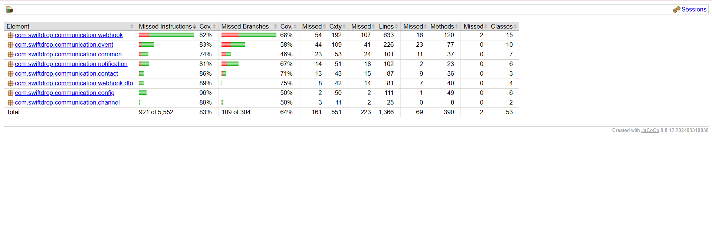

# Test report: notification-webhook-service

Owner: Member 10 (notifications and merchant webhooks)

## How to run

Docker Desktop must be running. The tests start their own PostgreSQL 17 and RabbitMQ 4
containers with Testcontainers, so your local `docker compose` services and `.env` are **not**
used. Tests that need Docker are skipped (not failed) when Docker is not available.

```powershell
cd services\notification-webhook-service
.\mvnw.cmd verify
```

`verify` runs every test, writes the coverage report, and fails the build if line coverage
drops below 60%.

| Output | Location |
|---|---|
| Test results (one file per test class) | `target/surefire-reports/` |
| Coverage report (open in a browser) | `target/site/jacoco/index.html` |
| Coverage numbers as CSV | `target/site/jacoco/jacoco.csv` |

Print the overall coverage numbers in PowerShell:

```powershell
$r = Import-Csv target\site\jacoco\jacoco.csv
$lc = ($r | Measure-Object LINE_COVERED -Sum).Sum;   $lm = ($r | Measure-Object LINE_MISSED -Sum).Sum
$bc = ($r | Measure-Object BRANCH_COVERED -Sum).Sum; $bm = ($r | Measure-Object BRANCH_MISSED -Sum).Sum
"Line coverage:   {0:P1}" -f ($lc / ($lc + $lm))
"Branch coverage: {0:P1}" -f ($bc / ($bc + $bm))
```

## Test setup

| Concern | Choice | Why |
|---|---|---|
| Database and broker | Testcontainers (`postgres:17`, `rabbitmq:4-management`), started once for the whole run in `support/AbstractIntegrationTest` | Real PostgreSQL and RabbitMQ behaviour (Flyway migrations, `FOR UPDATE SKIP LOCKED`, dead-letter routing) without depending on a developer's machine. Tests connect as the container's own user, which owns the `notification_webhook` schema created by `init-test-db.sql`. |
| Email | `@MockitoBean JavaMailSender` | No extra dependency or SMTP port; lets tests verify exactly what was sent. |
| Merchant webhook server | JDK `com.sun.net.httpserver.HttpServer` | Built into Java, no dependency. Can answer 500 then 200 to test retries, and records headers to check signatures. |
| Asynchronous checks | Awaitility | Waits for RabbitMQ consumers and the scheduled dispatcher without `Thread.sleep`. |
| Security | `spring-security-test` `jwt()` | Builds tokens with any role and `merchant_id` claim without a running identity service. |
| Test data | Random UUIDs in every test | Tests never collide with each other or depend on run order. |

## Test classes

### Unit tests (no Spring, no Docker)

| Class | What it proves |
|---|---|
| `notification/EmailTemplatesTest` | Every email (welcome, merchant decisions, each parcel status) has the right subject and text; the tracking link and failure reason are included. |
| `notification/SmsTemplatesTest` | SMS text for each status; always 160 characters or fewer; long failure reasons are cut with `...`. |
| `contact/ContactTest` | A newer `user.updated` event updates the contact; an older one that arrives late is ignored. |
| `common/PhoneMaskerTest` | Phone numbers are masked (`+9477****567`) before logging; short or empty values are fully hidden. |
| `webhook/WebhookSignerTest` | HMAC-SHA256 signature: valid signature verifies; changed body, wrong secret, expired timestamp and malformed header all fail; fixed test vector. |
| `webhook/WebhookSecretCryptoTest` | AES-GCM encrypt/decrypt round trip; startup fails fast with a clear message when `WEBHOOK_ENCRYPTION_KEY` is missing, not base64, or not 32 bytes. |
| `webhook/UrlSafetyValidatorTest` | SSRF protection: HTTP rejected when not allowed; loopback/private addresses rejected when not allowed; blank, malformed, non-HTTP(S) and too-long URLs rejected. |
| `webhook/RetryScheduleTest` | Retry schedule (`RetryPolicy`): 10s, 30s, 1m, 2m, 5m after attempts 1 to 5, then give up (6 attempts in total). |

### Integration tests (Spring + Testcontainers)

| Class | What it proves |
|---|---|
| `NotificationWebhookServiceApplicationTests` | The application starts and Flyway migrations V1 to V3 apply to a real PostgreSQL. |
| `config/SecurityConfigTests` | `/actuator/health` is public and hides details; other endpoints need a token. |
| `event/IdentityEventIntegrationTest` | **Event flow (required by the brief):** `user.registered` published to RabbitMQ creates the contact and sends one welcome email; a duplicate event sends nothing. Also: out-of-order updates, merchant approval email, missing contact, unreadable messages. |
| `event/ParcelEventIntegrationTest` | **Status change triggers notifications:** OUT_FOR_DELIVERY sends email and mock SMS; PICKED_UP sends email only; FAILED includes the reason; inactive contacts get nothing (recorded as FAILED); duplicates are skipped. |
| `event/DeadLetterIntegrationTest` | Unreadable messages on the identity and parcel exchanges end up in `notification-webhook-service.dead-letter` through the real broker. |
| `webhook/WebhookDeliveryFlowIntegrationTest` | **Merchant webhook with retry:** event to RabbitMQ, then delivery row, then the scheduled dispatcher POSTs to a real HTTP server. First answer 500, retry gets 200: DELIVERED after 2 attempts with a valid signature and no `customerUserId` in the body. Always 500: FAILED after 6 attempts, then a manual retry queues it again. |
| `webhook/WebhookIntegrationTest` | Subscription lifecycle (create, list, get, update, rotate, delete); `MERCHANT_NOT_APPROVED`; manual retry rules (404 for other merchant, 409 when not FAILED); merchant payload privacy; merchant suspended/reactivated pauses and resumes only system-paused subscriptions. |
| `webhook/WebhookAuthorizationTest` | **Authorization rules:** no token is 401; CUSTOMER/COURIER are 403; MERCHANT without `merchant_id` is 403; merchant B gets 404 for every operation on merchant A's subscription; `merchantId` in the request body is ignored; only DISPATCHER lists failed deliveries; the secret appears only on create/rotate; invalid URL and empty `eventTypes` are 400 `VALIDATION_FAILED`. |

## Latest results

Run on: 2026-11-20 (Windows 11, Java 25, Docker Desktop, `.\mvnw.cmd verify`)

| Measure | Result |
|---|---|
| Tests run | 71 |
| Failures / errors | 0 / 0 |
| Skipped | 0 |
| **Line coverage** | **83.7%** (1,143 of 1,366 lines) |
| **Branch coverage** | **64.1%** (195 of 304 branches) |
| Instruction coverage | 83% (4,631 of 5,552) |
| JaCoCo check (minimum 60% lines) | Passed |

Coverage by package (from `target/site/jacoco/index.html`):

| Package | Line coverage | Branch coverage |
|---|---|---|
| `com.swiftdrop.communication.webhook` | 83.1% (526 / 633) | 68% |
| `com.swiftdrop.communication.event` | 81.9% (185 / 226) | 58% |
| `com.swiftdrop.communication.notification` | 82.4% (84 / 102) | 67% |
| `com.swiftdrop.communication.contact` | 82.8% (72 / 87) | 71% |
| `com.swiftdrop.communication.webhook.dto` | 82.7% (67 / 81) | 75% |
| `com.swiftdrop.communication.channel` | 92.0% (23 / 25) | 50% |
| `com.swiftdrop.communication.common` | 76.2% (77 / 101) | 46% |
| `com.swiftdrop.communication.config` | 98.2% (109 / 111) | 50% |
| **Total** | **83.7% (1,143 / 1,366)** | **64.1%** |



The red stack traces printed during the run come from `DeadLetterIntegrationTest`, which sends
deliberately broken messages and checks that the service rejects them to the dead-letter queue.
They are expected.

## Bugs found by these tests (fixed)

| Bug | Fix |
|---|---|
| A failed webhook stored up to 255 characters of error text in `last_error`, which is `VARCHAR(200)`. Saving failed, so the delivery was retried forever. | Error text is capped at 200 characters, and the merchant's response body is no longer stored at all (only `HTTP <code>`). |
| A role check failure (`@PreAuthorize`) was caught by the generic error handler and returned **500** instead of **403**. | `ApiExceptionHandler` now returns 403 `FORBIDDEN` for `AccessDeniedException`. |
| A subscription secret that could not be decrypted threw on every poll, so that delivery was never finished. | The delivery is marked FAILED with "Secret could not be decrypted". |
